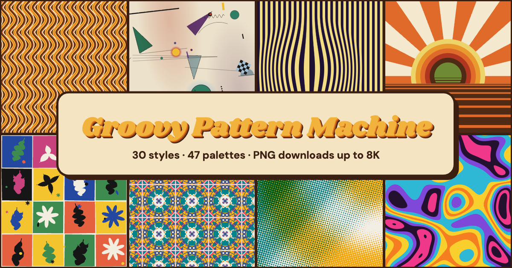

# Groovy Pattern Machine



Generate 1970s, Bauhaus, op-art and abstract patterns on demand, then download them as PNGs up to 8K (8192 × 8192).

**Live:** https://mcchord.net/patterns/

Everything runs in the browser. There is no server-side code, no build step and no dependencies. It is three ES modules and a stylesheet.

## Features

- **26 pattern styles in three families**
  - *1970s:* Groovy Waves, Rainbow Scales, Petal Drops, Loop Chain, Ogee Onions, Diamond Nest, Liquid Groove, Flower Power, Supergraphic, Mod Targets, Rainbow Tiles, Sunrise
  - *Bauhaus, geometric & op:* Bauhaus Blocks, Kaleido Quilt, Chevron Op, Truchet Rings, Tumbling Blocks, Op Squares, Op Bulge, Op Lines
  - *Art & abstract:* Composition, Floating Circles and Color Study (after Kandinsky), De Stijl Grid (after Mondrian), Cut-Outs (after Matisse), Atomic Age
- **43 curated palettes in four groups:** Seventies, Modern art, Pop & op, and Soft. You can edit any colour, add or remove colours, or shuffle their order. The first colour is the background.
- **Invent palette** makes up a new palette. Half the time it remixes a curated palette, turning its hues in OKLCH while keeping its value structure. The rest of the time it composes one from pigment rules. Results whose colours sit too close together are rejected and tried again.

## Palettes

Colour carries these patterns, so every curated palette follows the same rules:

- **Real references.** Each palette is drawn from the period or artist it names, for example 1970s appliance enamels (*Kitchen '74*), Mondrian's red, yellow and blue (*De Stijl*), Kandinsky's *Composition VIII* (*Kandinsky*), Matisse's gouache cut-outs (*Paper Cut-Outs*), Memphis laminates and stencil-printer inks (*Zine Inks*).
- **Paper or ink grounds.** Backgrounds are warm off-whites or deep inks, never pure white or black.
- **A value structure.** Every palette has a dark anchor, mid tones and a light accent, so a pattern still reads in greyscale.
- **Pigment-true hues.** Reds lean vermilion or crimson, blues ultramarine or cobalt, and yellows cadmium or ochre, rather than screen primaries.
- **Neighbours separate.** Inks are at least about 10 ΔE apart in OKLab, and about 12 from the ground, so bands never blur together.
- **Order matters.** Banded styles cycle through inks in order. Seventies palettes therefore run as gradients, the way 70s bands were printed, while modern palettes alternate warm and cool.

Invented palettes follow the same rules. Chroma is capped by hue at roughly what real pigments reach, so greens and cyans never go neon. Light tints lean slightly toward yellow and deep shades toward red-brown, as pigments do.
- **Palette from image.** Click *From image…*, or drop a photo on the page. The page clusters the photo's colours in OKLab and builds a palette from them using the same rules as the curated set. The image is read in the browser and never uploaded.
- **Flip ground** swaps the background with its strongest contrast, giving any palette a night or day version.
- **Variations.** Under the preview you see six other seeds of the current style. Click one to swap it in.
- **Your shelf.** *♥ Save* keeps favourite patterns in this browser, so you can come back to them.
- **Scale, Detail and Rotate** sliders.
- **Seeded and shareable.** The URL hash holds the full state (style, colours, seed, sliders, size), so a link reproduces the exact pattern. *Copy link* puts it on the clipboard.
- **PNG export up to 8192 px per side:** 8K UHD, 8K portrait, 8K square, 5K, 4K, phone and tablet wallpapers, your own screen, or a custom size.
- **Keyboard shortcuts:**

  | Key | Action |
  | --- | --- |
  | <kbd>Space</kbd> | New pattern |
  | <kbd>←</kbd> | Back |
  | <kbd>S</kbd> | Surprise me |
  | <kbd>P</kbd> | Invent a palette |
  | <kbd>[</kbd> <kbd>]</kbd> | Previous or next style |

## How it works

- **Resolution independent.** Each pattern draws in a logical space whose shorter side is 1000 units. The same spec therefore looks identical in the preview and in an 8K export.
- **Deterministic.** Global choices come from a seeded PRNG (`mulberry32`), drawn in a fixed order. Per-cell choices come from an integer hash of `(seed, i, j, k)`, so nothing depends on draw order or output size.
- **Big exports without big canvases.** `exportPNG` renders the image in horizontal strips of about 4 megapixels, on a software-rasterised canvas so every strip is drawn the same way. It applies the PNG "Sub" filter, then streams the rows through the browser's native zlib (`CompressionStream('deflate')`). It then writes the IHDR/IDAT/IEND chunks itself. Memory stays small and per-canvas size limits never apply, so 8K works on phones too. Most 8K UHD exports take under 2 seconds on a laptop.
- **Clean edges.** Edges are drawn so anti-aliasing never leaves seams:
  - Banded styles stroke one path several times, widest first, so the colour bands are truly parallel offset curves.
  - Same-coloured neighbours (quilt triangles, rainbow tiles, cube faces) are filled as one path, so no hairlines appear between them.
  - Op Lines draws filled ribbons rather than strokes, so tight crests never fold into pinholes.
  - Liquid Groove and Op Bulge are computed per pixel. Each pixel is anti-aliased from its distance to the nearest edge, measured in the pattern's own coordinates.

## Run locally

```bash
python3 scripts/serve.py
```

Then open http://localhost:8771/. The script is a plain static server that sends `Cache-Control: no-store`, so edits to the modules always load. Opening `index.html` straight from disk won't work, because browsers block ES modules on `file://` URLs.

`site/sheet.html` is a development contact sheet that renders many styles, seeds and palettes at once, for example `sheet.html?styles=waves,ogee&seeds=a,b,c&palette=harvest,disco&rot=20`. It is not deployed.

## Add a pattern

Add a `def(id, name, family, draw)` call in [`site/js/patterns.js`](site/js/patterns.js), and a one-line description in its `ABOUT` table. `family` is `'70s'`, `'geo'` or `'art'`. `draw(ctx, o)` receives:

| field | meaning |
| --- | --- |
| `o.W`, `o.H` | logical size (shorter side = 1000, or a covering square when rotated) |
| `o.rng()`, `o.rand(a, b)`, `o.pick(arr)` | seeded randomness; call in a fixed order |
| `o.hash(i, j, k)` | order-independent per-cell randomness in `[0, 1)` |
| `o.colors`, `o.bg`, `o.ink` | palette (all), background, inks |
| `o.scale`, `o.detail` | slider values (0.4–2.5, 1–10) |
| `o.px` | one output pixel in logical units, for seam overlaps |

The background is already filled when `draw` runs. Draw past the edges freely; the canvas clips. Pass `{ thumb: { scale } }` as a fifth argument to tune the style's thumbnail.

## Deploy

```bash
./scripts/deploy.sh
```

This rsyncs `site/` (minus `sheet.html`) to `/var/www/mcchord.net/patterns/` and checks each asset over HTTPS. Set `DEPLOY_HOST`, `DEPLOY_PATH` and `DEPLOY_URL` to publish elsewhere. The site uses relative paths, so it works under any directory, including GitHub Pages. When you change CSS or JS, bump the `?v=N` query strings in `index.html`, `app.js`, `core.js` and `sheet.html`.

## License

MIT. See [LICENSE](LICENSE).
